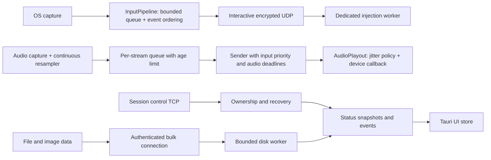

# แผนยกระดับความลื่นไหลและประสิทธิภาพ MineShare

วันที่ 27 ตุลาคม 2026 · ขอบเขต Windows + Ubuntu · Rust core + Tauri/React

ผลลงมือรอบ A อยู่ใน [รายงานก่อน–หลัง](../artifacts/round-a-20261027/report.md): ทดสอบ Windows ↔ Windows ตามเครื่องที่ผู้ใช้เปิดอยู่จริง แก้ mic continuity และเพิ่ม build/symbol guard แล้ว โดยไม่เลือก ThinLTO / codegen-units 1 สำหรับ GUI หลังผู้สมัครนั้นไม่ผ่าน native audio quality gate

ผลลัพธ์ที่ต้องการคือควบคุมอีกเครื่องได้ต่อเนื่อง เสียงไม่สะดุด การส่งไฟล์ไม่ทำให้คำสั่งควบคุมค้าง และใช้ทรัพยากรต่ำขณะพัก โดยตัดสินจากเวลาในเส้นทางใช้งานจริง โดยเฉพาะ p95/p99 ไม่ใช่เฉพาะค่าเฉลี่ยหรือ network RTT

เอกสารนี้เป็นแผนจากการตรวจโค้ดและหลักฐานเดิม ยังไม่ได้ปรับ production code หรือติดตั้งแอปใหม่ การตรวจอิง working tree ที่มีงานแก้ไขค้างอยู่จำนวนมากบน HEAD `15e5d36` ไม่ใช่ source เดียวกับผล benchmark เดิมทั้งหมด ก่อนเริ่ม implementation ต้องบันทึก revision, diff และ build flags ของ baseline ให้ทำซ้ำได้

**ข้อเสนอหลัก:** ทำ baseline → แก้ sample continuity และ build profile → คุมอายุคิวและการแย่งเวลาระหว่าง input/audio → แยกงานไฟล์ → ปรับ audio buffer อย่างมีหลักฐาน → ลดงาน UI/idle → ทดลอง optimization ของ Rust ที่ profiler ยืนยันว่าคุ้มค่า

**สิ่งที่ยืนยันแล้วจากโปรเจกต์**

| จุดตรวจ | หลักฐาน | ความหมายต่อแผน |
|---|---|---|
| มีพื้นฐานลด latency อยู่แล้ว | `runtime.rs:330` รวม motion ที่ receiver, `runtime.rs:380` มี injection worker, `runtime.rs:2513` รวม motion ที่ sender, Windows ใช้ native injection | รักษากลไกและ regression เหล่านี้ ไม่เสนอทำซ้ำเหมือนเป็นงานใหม่ |
| GUI เป็นคนละ Cargo workspace | `ui/src-tauri/Cargo.toml:2`; ยืนยันด้วย `cargo metadata --no-deps --locked` ทั้งสอง manifest | `lto="thin"` / `codegen-units=1` ใน root manifest ไม่สืบทอดให้ build GUI อัตโนมัติ; ต้องตรวจ flags ของตัวติดตั้งจริง |
| ไมค์บริโภค input เกินหนึ่ง sample frame | `cpal_mic.rs:331`, `cpal_mic.rs:384`, `resample.rs:21` | ที่ 48 kHz อ่าน 961 frame เพื่อสร้าง 960 frame และไม่เก็บตัวอย่างที่อ่านเกินไว้ใช้รอบหน้า |
| Audio มีคิวใหญ่หลังคิว capture | `runtime.rs:902` ใช้ broadcast 1,024 รายการ; `runtime.rs:1059` ส่งเสียงเข้าคิวนี้ | คิว capture 8 frame และ playback 8 frame ไม่ได้จำกัดอายุเสียงตลอดเส้นทาง |
| Input ยังสูญหายได้ก่อน coalesce | `runtime.rs:901`, `runtime.rs:2528`, `runtime.rs:2579` | broadcast 64 รายการทิ้งของเก่าเมื่อ consumer ตามไม่ทัน; การรวม motion หลังอ่านไม่กู้สิ่งที่ถูกทิ้งไปแล้ว |
| Input injection queue ยังไม่มี hard bound | `runtime.rs:247`, `runtime.rs:366` | motion รวมได้ แต่ discrete events ยังสะสมได้หาก OS injection ช้า ต้องกำหนดนโยบาย overload |
| การส่งเสียงรอหลัง input ใน loop เดียว | `runtime.rs:2488`, `runtime.rs:2615` | มีความเสี่ยง starvation เมื่อ input พร้อมต่อเนื่อง ต้องพิสูจน์ด้วย load test ไม่สรุปว่าเกิดทุกครั้ง |
| ไฟล์อยู่ใน control TCP และ reader รอ disk I/O | `runtime.rs:1819`, `runtime.rs:2151`; chunk 32 KiB / queue 8 ใน `files.rs:51` | writer priority ช่วยได้ระหว่าง message แต่ไม่ยกเลิกข้อมูลที่เข้า TCP แล้ว และไม่ช่วยขณะที่ reader รอเขียนไฟล์ |
| Hot path จัดสรร memory และแชร์ crypto lock | `runtime.rs:2463`, `pairing.rs:172`, `pairing.rs:199` | มีโอกาสลด allocation/copy; ผลของ lock ต้องวัดก่อนปรับโครงสร้างการเข้ารหัส |
| UI ลดงานตอนซ่อนแล้วบางส่วน | `App.tsx:40`, `App.tsx:149`, `ConnectionControls.tsx:16` | ไม่เสนอแก้ global transfer poll ซ้ำ; ที่เหลือคือ `Files.tsx:45`, `PairingModal.tsx:33` และการดึงข้อมูลซ้ำ |

หมายเลขบรรทัดอ้างถึงวันที่ตรวจ ไฟล์ Rust ในตารางอยู่ใต้ `crates/<crate>/src/` และไฟล์ UI อยู่ใต้ `ui/src/`

การทดลองแบบ deterministic เรียก `resample_and_chmap` จาก source จริง และใช้สูตรบริโภค input เดียวกับ mic loop: ตัวอย่างสุดท้ายของบล็อกแรกคือ 959 แต่ตัวอย่างแรกของบล็อกถัดไปคือ 961 จึงข้าม 960 จริง การทดลองนี้ยืนยันความไม่ต่อเนื่องของ sample ในเส้นทางดังกล่าว ไม่ใช่การวัดเสียงจากอุปกรณ์จริงหรือพิสูจน์สาเหตุของอาการสะดุดทั้งหมด

**Baseline ที่มีอยู่และสิ่งที่ยังขาด**

ผลเสียงจาก [รายงานวันที่ 23 ตุลาคม](../artifacts/audio-base-latency/report.md) เป็น source `73f4e9520e57` เส้นทาง Tee/LAN → laptop/Wi-Fi → Windows digital output:

| รูปแบบทดสอบ | Median | p95 | ข้อจำกัด |
|---|---:|---:|---|
| เสียงต่อเนื่อง | 155.54 ms | 161.90 ms | 192/192 markers; ไม่พบ quality events ใน 9,450 overlapping windows; ยังพลาดเป้าเดิม 155 ms อยู่ 0.54 ms |
| เสียงเป็นช่วงสั้น | 169.6 ms | 186.9 ms | เป็นคนละ workload ต้องเทียบก่อน–หลังแยกจากเสียงต่อเนื่อง |

ตัวเลขเหล่านี้ไม่ใช่ benchmark ของ working tree วันนี้ และไม่รวมเวลาของหูฟังจริงหรือภาพวิดีโอ รายงาน input v0.0.11 เป็นหลักฐานทางประวัติศาสตร์ ต้องวัดใหม่ก่อนใช้รับรอง input ปัจจุบัน

ยังขาด input capture-to-inject p95/p99 ของรุ่นปัจจุบัน, อายุคิวทุกช่วง, CPU/หน่วยความจำของทั้งแอปรวม WebView และผล mixed workload ระหว่างเมาส์ เสียงสองทาง และส่งไฟล์

**เป้าหมายการวัดผลที่เสนอ**

ตัวเลขด้านล่างเป็นเกณฑ์เริ่มต้นสำหรับเครื่องอ้างอิง ต้องตรึงหลังเก็บ baseline และก่อนทดลอง ไม่ใช่คำรับประกันบนทุกเครื่อง

| ประสบการณ์ | เป้าหมาย/เกณฑ์ผ่าน | วิธีวัด |
|---|---|---|
| เมาส์/คีย์บอร์ดบน LAN สาย | ที่ output 1,000 Hz: capture-to-inject p95 ≤5 ms, p99 ≤10 ms; ภายใต้ mixed load p99 ≤15 ms เป็นเป้าทดลอง | timestamps รายช่วง + clock calibration สองเครื่อง; แยก OS injection duration และ visible response |
| โหมดเมาส์ 60–1,000 Hz | วัดแยกแต่ละ rate; budget ต้องรวมคาบการส่งที่ผู้ใช้เลือก | ไม่ใช้เกณฑ์ 1,000 Hz ตัดสินโหมด 60/125 Hz |
| ความถูกต้องของ input | ไม่มี stuck keys, click ซ้ำ หรือระยะ motion หายจาก local coalescing; overload ต้องมีนโยบายที่ตรวจได้ | deterministic replay และ loss/reorder/disconnect scenarios |
| เสียงบนเส้นทางเดิม | ด่านแรก: continuous median ≤155 ms และ p95 ไม่ถอยจาก baseline ใหม่; ลดต่อเป็นช่วง 10–20 ms เมื่อคุณภาพผ่าน | อย่างน้อย 3 รอบต่อชุด, 192/192 markers, ไม่ใช้เฉพาะ markers ที่รอด |
| คุณภาพเสียง | zero observed gaps ≥2 ms, zero clipping/low-correlation windows, p05 correlation ≥0.99 ในชุดทดสอบเดิม | แยก continuous/sparse; รายงาน failed runs และ recorder errors ทุกครั้ง |
| เสียง latency ต่ำบน wired LAN | ทดลองช่วง 80–120 ms เฉพาะเมื่อ stage budget และผลอุปกรณ์รองรับ | เป็น stretch target ไม่เป็นเกณฑ์บังคับของ Wi-Fi |
| ส่งไฟล์พร้อมควบคุม | การส่งไฟล์เพิ่ม control p99 ไม่เกิน 5 ms จาก no-transfer baseline ในเงื่อนไขเดียวกัน | ไฟล์ใหญ่/หลายไฟล์, disk ช้า, ลิงก์จำกัด; รายงาน throughput ควบคู่กัน |
| UI | feedback หลังคลิก ≤100 ms; transition/drag p95 ภายใน 16.7 ms ที่ 60 Hz; ไม่มี long task >50 ms ใน flow ที่ทดสอบ | production Tauri/WebView ทั้ง Windows และ Linux |
| Idle | เป้าทดลอง CPU รวมเฉลี่ย <1% ของความจุเครื่องหลัง warm-up; ไม่มี memory/handle growth ต่อเนื่อง | แยก daemon/WebView/child processes, normalize CPU, วัด disconnected และ connected idle |
| Recovery | selected trusted peer reconnect p95 ≤5 s หลัง endpoint กลับมาเข้าถึงได้ | ไม่รวมเวลาเครื่อง boot/รอระบบเครือข่าย; ต้องเคารพ Disconnect & pause |

ห้ามใช้ RTT/2 เป็น input หรือ audio latency จริง เวลาจาก monotonic clock คนละเครื่องลบกันตรง ๆ ไม่ได้ ถ้า calibration error ใหญ่เกินผลที่ต้องการวัด ให้รายงานเฉพาะ stage duration ในเครื่องเดียวหรือใช้เครื่องมือวัดภายนอก

**ชุดงานตามลำดับความคุ้มค่า**

1. **P0 — สร้าง baseline และเครื่องมือวัดที่ใช้ตัดสินได้** · ขนาด M

   เพิ่ม sampled tracing ที่ capture → enqueue → serialize/encrypt → send และ receive → decrypt → enqueue → inject/playback พร้อม queue age/high-water, coalesce, drops, deadline misses และ p50/p95/p99/max เก็บ counters ใน hot path แล้วสรุปนอก callback; ไม่ log ทุก event หรือเก็บเนื้อหาคีย์/clipboard/audio ผู้ใช้

   ย้าย harness ที่ใช้ซ้ำจาก `artifacts/` เป็นเครื่องมือ benchmark ที่มี version ใต้ `tools/` หรือ `benchmarks/` ส่วน raw recordings ยังเป็น artifact ท้องถิ่น วัด overhead ของ instrumentation เปิด/ปิดเองด้วย

   เสร็จเมื่อได้ baseline ของ packaged GUI และ standalone daemon แยกกัน พร้อม source fingerprint, flags, machine/OS/audio-device metadata, workload และผลทุก run ยังไม่ต้องเปิดใช้ tuning ใหม่

2. **P0 — ทำ production build ให้ตรวจสอบได้ทั้งสอง workspace** · ขนาด S

   กำหนด release profile ของ Tauri โดยชัดเจน ทดลอง `opt-level=3`, thin LTO, codegen-units=1 เทียบกับ build ปัจจุบัน เก็บ debug symbols สำหรับ profiling/crash diagnosis แยกจาก payload แจกจ่าย เพิ่ม CI ตรวจ profile/flags ของ GUI และ CLI ไม่ใช่แค่ manifest root

   Cargo ใช้ profile จาก workspace root และ config/environment อาจ override ได้ จึงต้องเก็บ compiler invocation จริงด้วย [อ้างอิง Cargo](https://doc.rust-lang.org/cargo/reference/profiles.html)

   เสร็จเมื่อ installer จริงใช้ flags ที่ตั้งใจและ A/B ผ่าน correctness, startup, CPU, binary size และ latency; ไม่สมมติว่า LTO เพิ่มจะเร็วขึ้นเสมอ

3. **P0 — แก้ mic sample continuity และจัด callback ให้ทำงานจำกัด** · ขนาด S–M

   กรณี sample rate ตรงกัน ให้บริโภค input เท่าที่ใช้จริงและทำ channel mapping เท่าที่จำเป็น กรณี rate ต่างกันให้ resampler เก็บ fractional phase และ lookahead ข้ามบล็อก ไม่ทิ้งตัวอย่างส่วนเกินทุกครั้ง ทดสอบ 44.1/48/96 kHz และ mono/stereo ด้วย ramp/tone และ sample-count conservation

   ตรวจ callback ที่ `cpal_mic.rs:199`: ย้าย ring producer ให้ callback เป็นเจ้าของโดยตรงถ้าสอดคล้องกับอายุ stream; แทน callback logging ด้วย counters; ตรวจ wake mechanism ว่าไม่เพิ่ม blocking/การจัดสรรในเส้นทางเสียง ไม่อ้างว่า mutex นี้มี contention โดยไม่มี trace

   เสร็จเมื่อ same-rate ramp ไม่มี sample ข้ามบล็อก, อัตรา sample ระยะยาวถูกต้อง, quiet/sparse sounds และ mic FEC/DTX เดิมผ่าน และวัดเสียงจริงก่อนปล่อย

4. **P1 — จำกัดอายุเสียงตลอดทางและป้องกัน audio starvation** · ขนาด M

   ใส่ capture time/sample position และ enqueue time ในข้อมูลภายใน แยกคิว SysOut/Mic ที่มีเพดานจำนวนและอายุ; แทน audio broadcast 1,024 รายการด้วยคิวตาม latency budget เมื่อค้างให้ข้ามเสียงหมดอายุอย่างรู้ลำดับและนับเหตุการณ์ ทั้งนี้เริ่มจาก harness ก่อนกำหนดค่าคิวใหม่

   ที่ 50 packets/s คิว 1,024 รายการมีความจุเทียบเท่าเสียงประมาณ 20.48 s สำหรับหนึ่ง stream หรือ 10.24 s เมื่อสอง stream ส่งเต็มอัตรา นี่คือความจุเชิงทฤษฎี ไม่ใช่ latency ที่วัดพบ ปัจจุบัน capture queue เต็มจะทิ้ง frame ใหม่ด้วย `try_send` และเลข audio sequence ถูกสร้างใหม่หลัง silence suppression จึงต้องแยก intentional silence, capture drop และ network loss ให้ชัดก่อนเปลี่ยนนโยบาย

   ให้ sender มี time/work budget ต่อรอบเพื่อบริการ audio deadline และ input-state repair ได้ แม้ input พร้อมต่อเนื่อง รักษา ordering ระหว่าง key edge และ state snapshot; อย่าสลับลำดับ `select!` โดยตรงแล้วทำลาย invariant เดิม [อ้างอิง Tokio select fairness](https://docs.rs/tokio/latest/tokio/macro.select.html)

   เสร็จเมื่อจำลอง scheduler/network stall 20/50/100/160 ms แล้วอายุเสียงไม่เพิ่มสะสม, ไม่มี starvation ของสอง stream และ input p99/continuity ไม่ถอย การเปลี่ยน wire timestamp/sequence ต้องเจรจาความสามารถและมีทางเข้ากันได้กับ peer รุ่นเดิม

5. **P1 — ป้องกัน input สูญหายจาก local overload และเครือข่าย** · ขนาด M–L

   ทำ module `InputPipeline` ที่รวมการ enqueue/coalesce/ordering/recovery ไว้หลัง interface เดียว ใช้ bounded queue ที่แยกนโยบายของ relative motion, contact snapshots และ discrete events รวม motion ก่อนเกิด overflow และไม่ข้าม click/key/scroll/terminal barrier; รักษาระยะรวมและ mouse-rate preference

   กำหนดเพดาน/overflow policy ให้ receiver queue ด้วย Hook/OS callback ต้องไม่รอ network หรือ disk ถ้ารักษา discrete events ต่อไปไม่ได้ ให้ fail-safe คืน input ownership และ release held state พร้อมเหตุผล แทนการทิ้งแบบเงียบหรือขยาย memory ไม่จำกัด

   ทดสอบ UDP key-down/up ที่หายทั้งคู่ระหว่าง state snapshots: snapshot เพียงอย่างเดียวอาจซ่อม held state แต่กู้การแตะสั้นไม่ได้ หากยืนยันให้เพิ่ม bounded ACK/retransmit/dedup ของ discrete events พร้อม timeout/epoch และลำดับสัมพันธ์กับ motion; motion ที่เสียจาก network ต้องมีเกณฑ์ recovery แยกจาก local coalescing ห้ามรับประกันส่งครบเมื่อเครือข่ายขาดถาวร

   เสร็จเมื่อ burst 1,000 events, slow injector, duplicates/reordering, transient loss และ disconnect ทุกจังหวะผ่าน ไม่มีคีย์ค้าง/click ซ้ำ และ memory bounded [พฤติกรรม broadcast เมื่อ lag](https://docs.rs/tokio/latest/tokio/sync/broadcast/index.html)

6. **P1 — แยก bulk transfer ออกจากคำสั่งควบคุม** · ขนาด L

   ใช้ authenticated bulk connection แยกจาก control TCP โดยผูกกับ peer/session ที่ยืนยันแล้ว และมี lifecycle/cancel ร่วมกัน ให้ module `BulkTransfer` ถือ disk worker, bounded queues, integrity check, safe destination publishing และ progress aggregation

   ออกแบบ encryption context ของช่องใหม่อย่างชัดเจน: key/nonce/replay state ต้องไม่ชนกับ control/datagram และไม่ทำให้ replay window ของคนละ stream รบกวนกัน ไม่ clone cipher แล้วเริ่ม nonce จากศูนย์โดยไม่มี key separation

   แยก connection แล้วยังแย่ง bandwidth ของ NIC เดียวกันได้ จึงเพิ่ม pacing ตาม queue age/latency ของ interactive traffic วัด disk worker แยกจาก network เพื่อไม่ขยายคิวกลบคอขวด คง SHA-256, cancellation, path protection และไม่ overwrite ไฟล์เดิม

   เสร็จเมื่อ control/input/audio ผ่าน mixed-load gate แม้จำลอง disk ช้า, file cancel ตอบสนอง และ throughput ไม่เสียโดยไร้เหตุผล เริ่มด้วย negotiated capability/compatible fallback; ไม่เปลี่ยน transport ทั้งระบบเป็น QUIC โดยไม่มีผลเปรียบเทียบ

7. **P2 — ลด audio reserve แบบปรับตามสภาพจริง** · ขนาด L

   ทำหลังแก้ sampling/queue/fairness แล้ว เก็บ interarrival jitter, device callback timing, sample-clock drift และ queue occupancy ให้ module `AudioPlayout` ถือ policy เดียวสำหรับ startup, steady-state, sparse sound, outage และ catch-up

   baseline เดิมมี reserve 80 ms, high-water 100 ms, 20 ms packets และ Windows device request 20 ms; endpoint ที่เคยวัดจัดให้จริง 22 ms การลด requested period เป็น 10 ms จึงไม่แปลว่าได้ลดจริงอีก 10 ms

   ทดลอง adaptive reserve ลดช้าเมื่อ stable และเพิ่มเร็วเมื่อเสี่ยง underrun โดยมี hysteresis, min/max และ sparse-audio deadline เริ่มเป็น opt-in profile และ fallback กลับค่าปลอดภัยเดิม รักษา SysOut ที่ไม่ใช้ speech DTX และ Mic ที่มี DTX/FEC ตรวจ clock drift ระยะยาวก่อนเลือก resampling correction

   10 ms Opus packets และ native PipeWire/WASAPI refinements เป็นการทดลองต่อจาก stage budget ต้องวัด CPU/packets/เสียงขาดเพิ่มด้วย การทดลอง 10 ms Ubuntu capture เดิมมีเสียงขาด จึงไม่ใช้ซ้ำเป็น default โดยไม่แก้สาเหตุ

   เสร็จเมื่อ continuous และ sparse ผ่านแยกกันทุก run ที่ใช้รับรอง การลดค่ากลางโดย markers หาย/เสียงขาดถือว่าไม่ผ่าน และต้องเปรียบเทียบกับ baseline ที่ workload เดียวกัน

8. **P2 — ให้ GUI และงาน background ทำเท่าที่จำเป็น** · ขนาด M

   รวม status/transfer/connection state เป็น external store ที่มี revision, initial snapshot และ resync เมื่อเปิดหน้าต่าง ใช้ event push พร้อม rate limit ของ progress แทน poll ซ้ำที่ App/Files แยก selector เพื่อไม่ render ทั้งหน้าทุกสถานะที่เปลี่ยน

   PairingModal ยัง poll ทุก 500 ms แม้ไม่มี dialog; แทนด้วย backend event และกลไกแจ้ง request ที่ทำงานเมื่อซ่อนหน้าต่าง ไม่แก้ด้วยการหยุด poll อย่างเดียวจนผู้ใช้พลาดคำขอจับคู่ หน้า Files ต้องไม่ทำงานซ้ำเมื่อซ่อน

   เปลี่ยน idle audio demand/route polling เป็น notification ที่มี fallback timeout เฉพาะเมื่อวัดแล้วคุ้มค่า ตรวจ shutdown/device switch ให้ตื่นได้ทันที ใช้ lazy loading/memoization เฉพาะหน้าและ rendering ที่ profiler ระบุ

   เสร็จเมื่อ hidden/tray ไม่มี recurring UI polling ที่ไม่จำเป็น, request/transfer completion ไม่หาย, เปิดหน้าต่างแล้ว state ทันสมัย และ CPU/frame-time ดีขึ้นจาก production baseline

9. **P3 — ลด allocation/copy และใช้ Rust optimization ตาม profiler** · ขนาด M–L

   เปลี่ยน serialize/encrypt/decrypt ให้ใช้ reusable per-task buffers และ buffer pool ที่ bounded; เขียน nonce+ciphertext ลง output เดียวแทนสร้าง Vec ซ้อน ลดการ clone payload ด้วย ownership transfer หรือ shared immutable bytes เฉพาะที่มีผู้ใช้หลายคนจริง

   วัด crypto lock wait ก่อนแยก context; รักษา authentication, replay window, transport domain และ nonce exhaustion tests ทุกครั้ง การแยกโมดูล `WireCodec` ช่วยให้ benchmark ผ่าน interface เดียวกับ production ได้

   เมื่อ profiler ระบุ CPU bottleneck ค่อย A/B thin/fat LTO, codegen-units, PGO และ SIMD ของงานที่หนักจริง PGO ต้องใช้ workload แทนการใช้งานทั้ง idle, input, audio และ file transfer พร้อมแยก target/OS [อ้างอิง rustc PGO](https://doc.rust-lang.org/rustc/profile-guided-optimization.html)

   เสร็จเมื่อ improvement สูงกว่า measurement noise บนเครื่องตัวแทนหลายรุ่น และ p99/คุณภาพไม่ถอย ไม่ใช้ `target-cpu=native` เป็นค่า default ของตัวติดตั้งแจกทั่วไป ไม่เพิ่ม unsafe, allocator replacement, busy-spin หรือ lock-free rewrite เพียงเพื่อคาดหวังว่าจะเร็วกว่า

**โครงสร้างเป้าหมาย**

นี่เป็นการแยกความรับผิดชอบและนโยบาย ไม่ได้บังคับให้สร้าง thread หรือ crate ใหม่ทุกกล่อง Input/audio อาจยังใช้ UDP socket เดียวกันหาก deadline gate ผ่าน ย้ายงานออกจาก `runtime.rs` เฉพาะส่วนที่กำลังแก้และทดสอบ ไม่ทำ refactor ใหญ่พร้อมเปลี่ยน protocol ทุกอย่างในครั้งเดียว

**การจัดรอบส่งมอบ**

| รอบ | งาน | เงื่อนไขเริ่ม/จบ |
|---|---|---|
| A | 1 baseline → 2 build profile → 3 mic continuity | บันทึก baseline เดิมก่อนแก้; แยก changeset เพื่อระบุผลของแต่ละงาน |
| B | 4 audio queue/fairness + 5 input correctness | ใช้ harness รอบ A; จบเมื่อ overload/loss/mixed-load ผ่าน |
| C | 6 bulk isolation + 8 UI/background | ใช้ protocol compatibility และ event/lifecycle tests; ตรวจด้วยตัวติดตั้งจริง |
| D | 7 adaptive audio → 9 advanced Rust optimization | เปิดการทดลองทีละตัว; รับเฉพาะผลที่ผ่าน quality และมีประโยชน์เกิน noise |

S = เปลี่ยนเฉพาะจุด, M = เปลี่ยนหลายส่วนพร้อม regression, L = แตะ lifecycle/protocol/ฮาร์ดแวร์สองเครื่อง ขนาดนี้ใช้จัดลำดับ ไม่ใช่กำหนดวันเสร็จล่วงหน้า

**การตรวจรับและการถอยกลับ**

- ทดสอบ Windows ↔ Ubuntu ทั้งสองทิศ, Wayland/X11 ตาม support matrix, mouse 125/500/1,000 Hz, touchpad, mic/system audio เดี่ยวและพร้อมกัน
- ทดสอบ idle, input-only, continuous/sparse audio, large/many files, slow disk และโหลดรวม แยก wired กับ Wi-Fi ไม่รวมผลคนละ workload เป็นค่าเดียว
- จำลอง packet loss/reorder/duplicate และ scheduler stalls ด้วย harness/application-level proxy ก่อน การปรับ driver, registry, adapter หรือ power ทั้งระบบอยู่นอกแผนนี้
- ตรวจ selected-peer reconnect, pause/resume, เปลี่ยน IP/interface, sleep/wake, สลับ audio device, local takeover และ session epoch เพื่อไม่ให้ข้อมูล session เก่าหลุดเข้ารอบใหม่
- ใช้ regression ที่ interface สำคัญ: event order/distance, key release, sample continuity, silence/DTX, queue age, file integrity/cancel และ UI notifications; ไม่เขียน test เพียงเพื่อยืนยันค่าคงที่ตาม implementation
- หลังแต่ละ changeset รัน fmt/clippy/tests ที่เกี่ยวข้อง, frontend tests/build เมื่อแตะ UI และตรวจ GUI workspace แยกจาก root ใช้ CI Linux/Windows เดิมเป็นฐาน; compile ผ่านไม่แทน physical input/audio acceptance
- เก็บ latency distributions, quality events, CPU, RSS/private memory, WebView/child processes, handles และ thread count; warm-up ก่อนวัด เปรียบเทียบสลับ A/B หลายรอบเพื่อแยกผลจาก Wi-Fi ที่เปลี่ยนตามเวลา
- เพิ่ม soak test 8–24 ชั่วโมงในรอบก่อน release: ไม่มี queue growth, memory/handle leak, audio drift เพิ่มสะสม หรือคีย์ค้าง รายงานความแปรผันและทุก failed run
- ให้การทดลองที่เสี่ยงมี feature/config switch พร้อมค่าปลอดภัยเดิม เก็บ installer/baseline ก่อนหน้าและ schema compatibility หาก regression ให้ revert เฉพาะ changeset โดยไม่ย้อนงานอื่นของผู้ใช้
- หยุด optimization เมื่อผ่านเกณฑ์ที่ตรึงไว้ และ profiler ไม่พบคอขวดที่แก้แล้วคุ้มค่า ไม่ไล่ตัวเลขจนเพิ่มความเสี่ยงต่อความถูกต้องของ input/เสียง

**สิ่งที่ตรวจแล้วในรอบวางแผนนี้**

อ่าน manifest/build configuration, input/audio/network/session/file/UI paths, CI และรายงาน benchmark ที่เกี่ยวข้อง; ยืนยันสอง workspace ด้วย Cargo metadata; ทำ isolated reproduction ของ mic sample skip สำเร็จ ยังไม่ได้รัน full regression suite, benchmark สดสองเครื่อง, build installer หรือตรวจสภาพแอปที่กำลังติดตั้ง จึงไม่มีการอ้างว่าประสิทธิภาพ production ดีขึ้นแล้ว

เริ่ม implementation ที่รอบ A ให้ได้ baseline ที่ทำซ้ำได้และแก้สองจุดที่มีหลักฐานตรงก่อน จากนั้นใช้ queue age, deadline misses และ p99 เป็นตัวตัดสินงานรอบถัดไป
